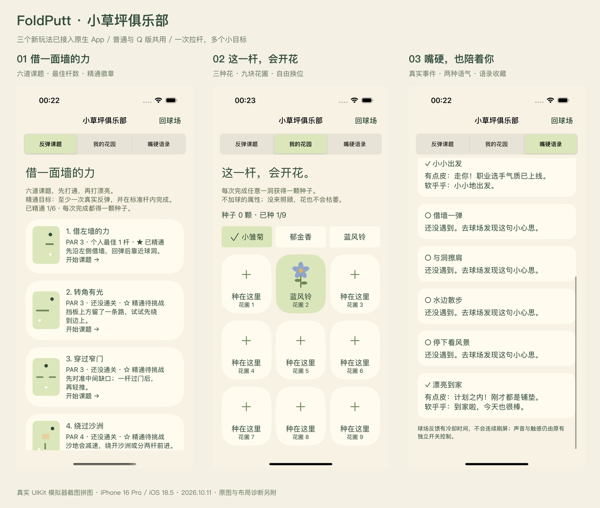

# 三个玩法的原生交付 · 2026-10-11

已将用户接受的组合 **07 反弹解谜 + 04 花园 + 03 嘴硬球友**接入 Swift/UIKit App，使用既有物理、拉杆、普通/Q 模式与 scene 恢复。十二方向浏览器体验馆保持独立，可继续比较其他候选。

## 打开与体验

运行 FoldPutt 后选择普通或 Q 版，点工具栏叶子图标 **“玩法与收藏”**。

1. **反弹课题**：六张新地图直接开放，点卡片即重新开局。通关记录最佳杆数；至少一次反弹且标准杆内完成获得精通徽章。
2. **我的花园**：每次真实完成任意一洞得一颗种子，选择花种再点空地。点已有花可收回种子、换位置或换品种。三种花、九个位置，本地自动保存。
3. **嘴硬语录**：有点皮、软乎乎、安静打球三种选择。真实击球事件解锁语录册，六类事件、十二句；不会改变球路与分数。

进入收藏会暂停球路；直接回球场继续同一局。新地图也可在原地图菜单中选择，普通/Q 共九图。原三图与反弹六图分别循环。既有一杆慢放、烟花、滚动锁杆、安全区边界保留。

上图为三张真实 UIKit 模拟器截图的缩放拼图，未改动屏幕内容；原始 PNG 与逐张布局证据见 [截图清单](screenshots/club-native/manifest.json)。不是浏览器原型或生图。

## 实现与依据

新增 FPClubProgress/Store、FPClubController、六份关卡资源，接入会话的真实事件和结算。收藏使用 UserDefaults，写入前重新加载以兼容多 scene；奖励收据按对局 UUID 持久保存，恢复进洞前快照也不能重复领种子。普通游戏状态仍按 scene 保存，收藏为 App 内共享。截图用真实 UI 拖拽产生胜利，没有注入获胜或伪造奖品。测试使用隔离存储，交付 App 不预填进度。

本轮没有增加网络、账号、引擎依赖、广告或付费。产品规则详见 [规格](../specs/club-native.md)。120 秒 / 12 碰撞为新课题的暂定调优值，不是附件事实。组合旨在提供技巧复玩、轻收藏与角色辨识度；尚未做市场用户测试，不能据此承诺留存或市场占有率。

## 验证结果

| 验证 | 结果与证据 |
|---|---|
| 单元测试 | 50/50；Final.xcresult、final.log。新增八项覆盖去重、恢复、多 scene、种植守恒、精通、语录、暂停与六图可解性 |
| 原生 UI（减少动态效果） | 四条流程通过：三条新增收藏测试＋原有双模式地图/滚动锁杆/回放回归；UI.xcresult、ui.log |
| 原生 UI（普通动效） | 三条新增流程通过；Final.xcresult。真实拖杆、WIN、种子、种植/收回/换花、语录及精通 |
| 最大 Dynamic Type 加强检查 | 竖/横屏三页可达，实际滚到第九花圃并点击弹出缺种子提示；LargeTextVerified.xcresult、large-text-verified.log |
| 六课题可解性 | 原生 session/physics 实际执行求得路线，全部在标准杆内且至少一次碰撞；P01–P03 一杆，P04–P06 两杆。仅 P01 另做 UI 手势通关 |
| DUO 当前屏幕 | iOS 27.1 实际模拟器一条 UI 流程通过：P01 真实反弹进洞、精通记录、进入收藏暂停/返回；Duo.xcresult、duo-ui.log |
| Release | 模拟器 Release 构建成功；release.log |

全部过程文件在 `work/club-native/`，保留早期失败与最终成功记录。大字体补测曾因 XCTest 粗粒度上滑越过第九花圃、可点判断包含裁剪细条而误点；已改为短距离拖动，要求至少 44pt 可见高度后点击可见区域，实际弹窗断言通过。该修正只改测试，没有隐藏失败或修改玩法规避测试。早期 Swift Sendable 字体配置警告已修正；最终只剩无 AppIntents 依赖的元数据跳过提示和 SDK 版本解析诊断，不影响构建/测试成功。

## 环境与覆盖边界

- Xcode 27.1 (27A9269)，iOS Simulator SDK 27.1；工程最低部署 iOS 18。
- iPhone 16 Pro 模拟器，iOS 18.5，402×874pt（横向 874×402pt）。收藏竖屏 traits compact/regular，四边 safe area 为 100.333/0/34/0pt；横屏 traits compact/compact，详见每张 layout.txt。所有四边独立记录。
- iPhone Duo 模拟器，iOS 27.1，本轮采样 466×678pt，traits compact/regular。收藏 safe area 82/0/34/84pt；division 空；occlusion 为 (399.667,29.333,37,37) 与 (382,0,84,170)。数据来自当时 view/reservedRegions，不是手造夹具。
- DUO 启动日志曾报告迁移提示，但随后安装、运行与上述 XCTest 已成功；不把早期启动提示等同于最终失败。
- Mac 处于锁屏，Device Hub 无法完成实际开合、旋转、半折，因此本轮没有宣称内屏 regular 布局或完整折叠矩阵验收。真机触觉/光学/握持/温度及完整 VoiceOver 仍未测。
- 同时覆盖 Reduce Motion 开/关；收尾已将 iPhone 16 Pro 模拟器恢复到测试前的开启状态。截图采集时多数为关闭，以各 layout.txt 为准。

原文件备份：`work/club-native/before/`；最终源码差异：`work/club-native/changes.diff`。本轮未提交、推送、发布或安装到实体设备。
