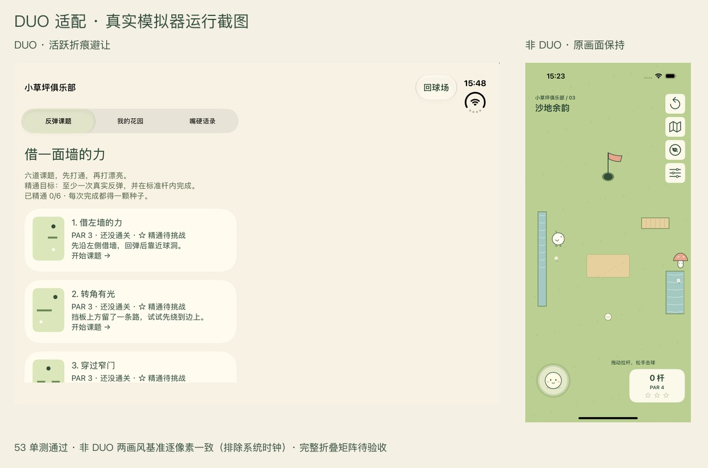

# DUO 适配与非 DUO 回归 · 2026-10-11

本轮按用户指定 duo-fit 技能实施，目标是修复 DUO 区域避让和连续变化，并保留普通 iPhone 的球场体验。用户已明确撤销此前提供的 AGENTS.md 约束；本轮以最新授权为准，不改写历史规范内容。

## 已修复

- 系统未激活的 division 保留为既有球场运河视觉/规则数据，但不再挤压收藏页、模式选择页和 HUD 的交互空间。展开内屏可使用完整安全区；激活 division 与活跃 occlusion 继续避让。
- `UIView.ReservedRegion.frame` 已包含 interaction margins；移除 `usable` 中再次膨胀 8pt 的处理。四边 safe area 继续独立读取，不镜像推断左右。
- 球场在 bounds 相同但 safe area / regions 变化时取消尚未释放的拉杆。正在滚动的球位、速度、杆数、launch ID 保留。
- 收藏页按稳定内容 ID 和卡片内比例保存阅读锚点，尺寸、字号、列数、display scale 改变后恢复当前位置；普通尺寸类切换不再无条件重建所有卡片。切换标签仍正常回到页首。
- 收藏页、模式选择、游戏容器显式响应安全区变化；使用 UIKit 当前容器空间与系统导航，无设备名分支、全局屏幕或 deployment target 上调。

## 基线与布局模型

Xcode 27.1 (27A9269)，iOS Simulator SDK 27.1，最低 iOS 18.0。已检查最终 Debug App Info.plist：`UILaunchScreen` 存在，SceneDelegate 实际配置有效，多场景开关 false，支持四个方向，`UIRequiresFullScreen` 不存在。保留这些配置，未擅自开启多窗口。

当前真正运行链路是 `FPGameRootController → FPAdaptiveController → UINavigationController → FPPlayLayoutController`。它是自定义全屏游戏画布；旧 `FPArrangementController` 仍在工程内，但当前 root 不实例化它。本轮没有为了使用新容器切换现有根，避免影响普通机型；收藏使用标准 UINavigationController，滚动内容布局在最大可用连续矩形内。折痕/摄像区是局部矩形集合，不是额外统一 inset。

Apple 原文与本机 SDK 于本轮重新核实：

- [ReservedRegion.frame](https://developer.apple.com/documentation/uikit/uiview/reservedregion/frame)：frame 已含 margins。
- [reservedRegions](https://developer.apple.com/documentation/uikit/uiview/reservedregions(kind:options:))：按 kind/options 查询；实际 SDK 提供 isActive、includeInactive，iOS 27.1 availability。
- [自动 trait tracking](https://developer.apple.com/documentation/uikit/automatic-trait-tracking) 与 [trait 变化](https://developer.apple.com/documentation/uikit/adapting-your-app-when-traits-change)：按依赖更新，初始化仍需执行。

下载原文 JSON、本次扫描与有效配置保存在 `work/duo-fit-20261011/`。本轮未重新核实 Apple 下载页的正式版/RC 发布状态，不将本地版本号当作发布状态证明。

## 审计覆盖

| 文件/模块 | 判定 | 理由与更新路径 | 验证 |
|---|---|---|---|
| FPRegions | 修复 | active 与 inactive 分离；frame 不重复加 margin | 无区域、未激活、激活、多区域单测 |
| FPAdaptiveController | 修复 | 相同 bounds 的 safe-area/regions 变化取消在途拖杆；不取消已击球 | 状态单测、真实 UI 返回 |
| FPClubController | 修复 | 稳定阅读锚点；字体/scale 重建；尺寸/安全区重新布局 | reflow 单测、手机横竖屏、DUO 可达性 |
| FPModeSelectionController | 修复 | safe-area 变化显式使布局失效 | 既有安全区与滚动路径保留 |
| FPControlsController / FPCourseView / FPPullControl | 保留 | 当前容器 bounds、各边 inset、世界坐标投影、≥44pt 控件、动态锁杆；自定义工具组适用于沉浸球场 | 非 DUO 像素对照、HUD 区域矩阵、击球回归 |
| FPChibiArt / FPLevel / FPTheme | 保留 | 固定值分别是绘画比例、世界坐标与触控/视觉令牌，不是机型断点 | 两画风对照、既有物理测试 |
| AppDelegate / SceneDelegate / Info.plist / pbxproj | 保留 | 本地 scene/window、按 scene checkpoint、有效启动屏与方向；无深链/键盘业务 | 有效产物核对；前轮恢复测试保留 |
| 旧 FPArrangementController | 不在运行路径，保留并说明 | 存量备用容器，不借本次适配切换整个游戏根 | 静态核实调用链 |
| 相机采集、accessory、多窗口、键盘 | 不在范围 | 产品没有相关业务，不新增入口 | 不宣称验收 |
| 全折叠/分屏/辅助功能矩阵 | 待验证 | 见下方运行边界 | 不以静态扫描代替 |

扫描考虑了 23 份源代码/配置，命中 14 份文件。固定几何候选按绘画/世界坐标/令牌/夹具逐项阅读；没有批量删除有意义的常量。`work`、第三方与历史浏览器原型不属于本次原生运行修改范围。

## 已执行验证

### 复验（2026-10-11 19:29–19:40，代码未再变动）

| 命令范围 | 设备 | 结果 |
|---|---|---|
| `-only-testing:FoldPuttTests` | iPhone 16 Pro / iOS 18.5 | 54 项通过，含新增“中缝水道与无中缝双球路”回归 |
| 5 条课题/收藏流程 | iPhone Duo / iOS 27.1（951×669 展开内屏） | 5 条通过，含真实借墙球进洞拿精通、花园/语录流程 |
| 5 条课题/收藏流程 | iPhone 16 Pro / iOS 18.5 | 5 条通过 |
| `-only-testing:FoldPuttUITests`（22 条） | iPhone 16 Pro / iOS 18.5 | 14 通过、8 失败（既有失败，见下） |

全量 UI 套件中 8 条失败全部在 `FPPrototypeUITests`（半窗夹具、选项弹层、掌机菜单、Q 版换关、调参奖惩流程）。用 `git worktree add work/base-tree HEAD` 在未包含本轮改动的 HEAD 副本上执行同样 6 条用例（验完已移除副本，日志保留），同样 8 失败，逐条报错文本一致（`work/base-prototype.log` 对 `work/duo-fit-20261011/phone-full-ui.log`），因此判定为仓库既有失败，与本次 DUO 适配无关，本轮不修。

变量改名后单独复验两条借墙球分支：普通 iPhone 走无中缝球路（拖动偏移 39.3/22.7pt，一次进洞）、DUO 展开内屏走折痕球路（拖动偏移 −30.0/21.0pt，一次进洞，未触发“重开”），见 `phone-bank-rerun.log`、`duo-bank-rerun.log`。

证据：`work/duo-fit-20261011/unit-after-calibration.log`、`DuoFinalRerun2.xcresult`、`duo-final-rerun2.log`、`DuoGardenRerun2.xcresult`、`duo-garden-rerun2.log`、`PhoneFullUi.xcresult`、`phone-full-ui.log`、`PhoneBankRerun.xcresult`、`DuoBankRerun.xcresult`、`work/base-prototype.log`。

### 本轮发现：折痕水道会改掉课题的唯一球路

展开内屏的中缝不只是视觉，它在球场里是一条带桥面的水道（`FPCourseProjection.banks` → `updateReservedBanks`），球只能从桥面通过。用物理枚举（角度 1°、力度 1/99 步进）测得：

- P01 在无中缝场地上有 18 组可进洞球路，在折痕水道场地上是另外 44 组，两组无交集；UI 用例原先固定的 30° 借墙球只适用于无中缝场地。
- 折痕水道下的球路随水道在世界坐标里的位置变化（世界 y 偏移 ±0.08 内各组球路互不通用），所以按“场地有无中缝 + 可重试的校准球路”改写用例：无中缝用原 30° 球，有中缝用 5 条借墙球候选，未进洞时点“重开”回到同一发球位再试下一杆。
- 新增单测 `testPuzzleBankRouteCoversCleanAndFoldedCourse` 固定这两条校准球路，物理或投影一旦变化会先在单测暴露。

这是既有玩法设计（折痕＝水道＋桥面，见 `docs/duo-design-options.md`）与课题球路的交互结果，不是本轮布局改动引入；非 DUO 无中缝，不受影响。已确认保持现状：中缝水道在课题里同样生效，课题在展开内屏允许有与手机不同的解法，不为统一解把水道限制到练习场。

### 首轮验证（同日 15:15–15:57）

- **53 项单元测试通过**，包含新增未激活折痕/边距、相同尺寸安全区变化时击球连续性、收藏内容重排锚点三项。
- **普通 iPhone 16 Pro / iOS 18.5：6 条 UI 流程通过**。Phone.xcresult 中五条覆盖普通/Q 地图、回放锁杆、真实花园、精通与最大字号；PhoneRotation.xcresult 补一条真实旋转后阅读位置与同一 launch ID。
- **非 DUO 前后像素对照**：固定第三张地图、两种画风、Reduce Motion 开启，402×874pt、safe area 62/0/34/0。排除顶部 62pt 系统时钟后，两张图的所有 RGB 通道完全一致；布局诊断也一致。结论限于该可复现基准与上述行为回归，不等于穷举所有非 DUO 设备。
- **DUO / iOS 27.1**：反弹精通与暂停流程、大字号第九花圃可达、收藏返回同一球局通过。一次花园流程受其他 App 前台/屏幕状态变化干扰失败；随后 DuoGarden.xcresult 单独重跑通过，未更改断言。三页当前屏幕操作在 DuoScreens.xcresult 通过，随后 DuoFramebuffer.xcresult 复验通过，并按 Documents 实时诊断采集 display 3 framebuffer。该次实际报告 vertical division 为 active，三页内容避开中缝；不是靠设置 XCTest orientation 推断半折。
- DUO 实际采样同时出现 466×678pt compact/regular 与 951×669pt regular/regular。展开态曾读到 division (455.5,0,40,669) 且 activeDivision 空；收藏安全区 82/0/34/84。后续部分帧 regions 空，以各帧证据为准，不拿一次读数概括所有姿态。
- **Release 模拟器构建通过**。最终生产 Swift 没有新增编译警告；SDK 日志有版本解析和 accessibility duplicate-class 等环境诊断，保留原始日志。

证据目录：`docs/screenshots/duo-fit-20261011/`；逐帧系统、traits、四边 safe-area、regions 与来源见 manifest.json。原始失败记录留在 work。黑屏或截到 SpringBoard 的图片不列作有效 App 截图。

## 覆盖限制

终端用 System Events 操作 Device Hub 返回 -1728（无辅助访问权限）。运行期间观察到真实 compact 与 regular 屏幕，但未通过受控流程完成开→合→旋转→书本半折→桌面半折连续矩阵。DUO 的 XCTest orientation 请求不保证改变实际窗口：若前后 bounds 未变，只证明该尺寸下仍可用，不能写成实际旋转通过。

本机 27.1 runtime 仅支持 iPhone Duo；创建普通 iPhone 18 Pro / 27.1 被模拟器以不兼容设备拒绝，因此普通手机运行回归使用可用的 iOS 18.5，另以旧系统 availability 和空区域单测覆盖回退。

实际左右 Split View、PiP、内屏两种半折、VoiceOver/RTL/降低透明度完整流程与 Instruments 连续变化性能未验收。无真机光学、触觉、温度、握持测试。未重新做市场或功能玩法调优。本轮代码修改留在工作区，未自动提交或推送。
