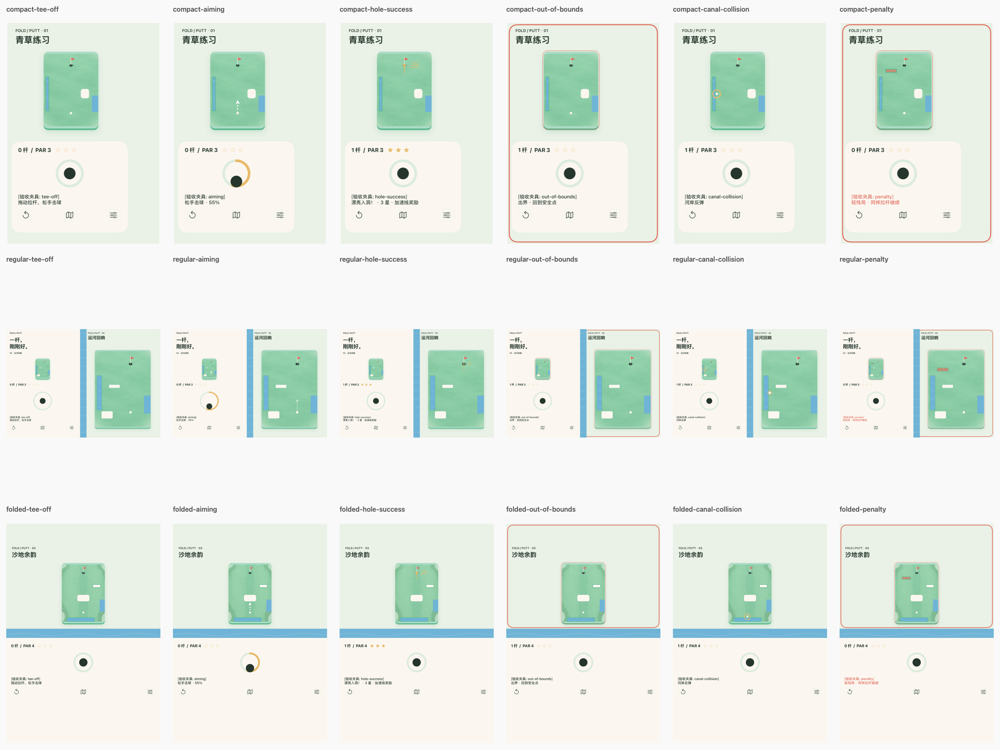

# Physics v1：3 关可玩原型

工程：`/Users/cws/Desktop/FoldPutt/FoldPutt.xcodeproj`，Scheme `FoldPutt`，bundle ID `com.foldputt.prototype`。技术栈 Swift + UIKit，iOS 27.1 SDK，最低 iOS 18；无 SwiftUI/Objective-C 实现，无第三方运行依赖。

## 本轮改动与文件

```text
FoldPutt/
├── Models/FPLevel.swift                      # JSON 模型、合法性校验、division 映射
├── Models/FPDemoSession.swift                # 保留文件名；已接真实物理/奖惩，不再 mock 运动
├── Systems/Physics/FPPhysicsWorld.swift      # 单球二维固定步长模拟
├── Systems/Physics/FPPhysicsPort.swift       # 沿用发射数据/接口；mock 仅供记录型测试
├── Resources/
│   ├── Levels/01-meadow.json                 # 青草练习，建议 compact
│   ├── Levels/02-canal.json                  # 运河回响，建议 regular
│   ├── Levels/03-sand.json                   # 沙地余韵，建议 folded
│   ├── Exports/star-1024.png                 # 新增透明 PNG；球/旗 PNG 已有
│   └── Assets.xcassets/
│       ├── ConceptCompact.imageset/
│       ├── ConceptRegular.imageset/
│       ├── ConceptFolded.imageset/
│       └── RewardStarSprite.imageset/
├── Tests/FPPhysicsTests.swift
├── UITests/FPPrototypeUITests.swift          # 真实拉杆通关、选关/掌机流程
├── Tools/capture_physics.py                  # 显式 Debug 事件取证
└── docs/
    ├── physics-v1-plan.md
    ├── physics-v1.md
    └── screenshots/physics-v1/               # 18 事件图 + 正常通关证据 + JSON
```

现有球道、操控区、SceneDelegate、两个适配容器、工程资源引用和资源生成器同步更新。改动前副本在 `work/physics-v1/before`；完整新增/修改文件清单在 `work/physics-v1/changes.json`。现有资源和历史截图保留，不混入本轮结果。

## 资源落地

| 资源 | 当前用途/检查 |
|---|---|
| 3 张已有 AI 概念图 | 新增 ConceptCompact / ConceptRegular / ConceptFolded Image Sets，保留原图；仅美术预览资源，不铺成可点击界面 |
| 2 张 AI 草地背景 | 沿用 GrassCompact / GrassRegular，绘于球道内；无球、洞、按钮或碰撞数据 |
| 球/旗/星星 PNG | Resources/Exports 下各 1024×1024，真实 alpha；Star 新增；已有球旗复用 |
| 9 个 PDF 游戏件 | Single Scale，Preserve Vector Data；箭头、星形、速度线可模板 tint |
| UI 图标 | 原有 SF Symbols；没有 AI 按钮、付费/购买入口 |
| CanalTile / GrassEdgeTile | 程序化可平铺材质；河岸轮廓按世界碰撞矩形绘制 |
| AppIcon | 1024×1024 无 alpha 主图，沿用现有 universal iOS AppIcon，由 Xcode 编译变体 |
| Color Sets | 11 组 Light/Dark 语义颜色；未改库里的品牌 HEX |

新增星星由系统 AppKit/Core Graphics 确定性生成；本轮没有重新请求 AI 生图。概念资源与运行截图分别存放，不能互换证明用途。

## 物理与输入

- 世界坐标固定为 1 × 1.4；UI 投影等比例缩放，球半径 0.022。速度以世界单位/秒计，发射角为弧度；输入 x-right/y-up 在物理入口转换为 y-down。
- CADisplayLink 驱动 1/120s 固定步长。每步再限制移动距离不超过半个球半径，避免穿过薄矩形河岸。异常长帧限制追帧，后台暂停计时与运动。
- 草地摩擦 0.42，沙地 1.05；反弹系数 0.78，最大初速度 1.55。JSON 可调，属于首轮玩法参数，不宣称真实高尔夫单位。
- 矩形边界反弹、静态矩形障碍碰撞；水域是出界触发区。洞口距离 ≤0.065 且速度 ≤0.52 才捕获，高速掠过不会直接进洞。
- 拉杆/球本体必须从合法热区开始；按实际 touch-down 点计算方向与拉距，死区取消，松手只发一次 launch/计杆。箭头和力度环共享预览状态。
- 圆球与轴对齐矩形是本轮支持的形状；不扩成通用物理引擎。关卡非法/缺失时显示加载错误，不静默进入损坏场景。

## 中缝碰撞的含义

根视图查询真实 division，然后转换到球道视图坐标。若中缝位于左侧操控区与右侧球道之间，直接把整个根视图缝矩形当碰撞体会让球永远碰不到；本实现将它投影到球道内距它最近的可见边缘河岸。横向 division 对应可见上/下边缘河岸。

这个投影使用系统区域的方向/厚度与实际 field 尺寸，不使用铰链角、设备方向或 idiom。映射后矩形交给 `FPPhysicsWorld.canal`，同一份矩形用于绘制、反弹和取证；无 division 时用 JSON fallback。若新区域会覆盖当前球、安全点或洞口则保留原静态快照，防止布局切换挤球。

静态碰撞在新一杆前提交；aiming/rolling/captured 期间不移动墙。折叠只重排投影，当前运动不重置。半折截图中的河岸反弹事件有真实速度反向和 collision 记录。所有按钮仍避开系统 division/occlusion rect，铰链数值从未传入物理。

## 关卡与奖惩

三关通过控制面板“设置与演示”中的关卡按钮/下一关选择。`presentation` 仅是关卡美术与验收建议，不控制布局；所有关卡在普通 iPhone 和每种姿态都能玩。

| 规则 | 行为 |
|---|---|
| 杆数 < par / = par / > par | 3 / 2 / 1 星，只在合法入洞后结算一次 |
| ≤ par | 金色加速线表现奖励；不永久改球速，不设货币或升级 |
| 出界/落水 | 速度归零，回最近一次合法稳定停球点；起点兜底，本杆已计的杆数保留 |
| 60s 有效前台时间或累计 5 次独立障碍/边界接触 | 待球停止后进入一次轻残局，增加 JSON 预设的小障碍 |
| 惩罚障碍位置不合法 | 回安全点；不会把障碍刷在球/洞/存档安全点上 |
| 残局 | 同样拉杆继续；不重复叠加惩罚，允许免费重开/换关，无生命墙 |
| 后台或 scene 失活 | 取消未松手拉杆；暂停球与计时，恢复不重复击球 |

持续贴墙不每帧算一次碰撞；必须真正分离后再次接触才新增。成功覆盖同杆后续失败处理，避免重复星级。当前不做长期账号/赛季进度或云存档。

## 动效与无障碍

草皮 0.6s、旗杆 0.4s、入洞粒子 0.8s、红边 0.3s。开球动画仅作用于球场绘制层；Reduce Motion 关闭揭幕/生长/粒子/波纹等大动效，保留文本和稳定状态。UIHingeInteraction 只触发这些表现，不切页面结构、不改风/坡/球速/分数。

## 编译与正常游玩验证

```sh
cd /Users/cws/Desktop/FoldPutt
export DEVELOPER_DIR=/Applications/Xcode.app/Contents/Developer
FP_DUO=2B7D0712-AB02-4854-86C5-7FC76DD406F5
xcodebuild -project FoldPutt.xcodeproj -scheme FoldPutt \
  -sdk iphonesimulator27.1 -destination "platform=iOS Simulator,id=$FP_DUO" \
  -derivedDataPath work/DerivedData CODE_SIGNING_ALLOWED=NO build
xcrun simctl install "$FP_DUO" work/DerivedData/Build/Products/Debug-iphonesimulator/FoldPutt.app
xcrun simctl launch "$FP_DUO" com.foldputt.prototype
xcodebuild -project FoldPutt.xcodeproj -scheme FoldPutt \
  -destination "platform=iOS Simulator,id=$FP_DUO" \
  -derivedDataPath work/DerivedData -parallel-testing-enabled NO test
```

第一关从拉杆中心向下拉至约 55% 松手，可沿直线一杆入洞。选择第二关，向可见蓝色河岸拉杆，观察反弹；向右侧水域击球，观察安全点回退；第三关穿过沙地会明显减速。多次碰障或等待 60 秒触发轻残局，红色小障碍出现后继续拉杆。

## 截图证据与复现

路径统一在 `/Users/cws/Desktop/FoldPutt/docs/screenshots/physics-v1/`。

| 姿态/关卡 | 六个事件文件前缀 |
|---|---|
| 真实 DUO Closed / 01 | compact-tee-off、compact-aiming、compact-hole-success、compact-out-of-bounds、compact-canal-collision、compact-penalty |
| 真实 DUO Open / 02 | regular-tee-off、regular-aiming、regular-hole-success、regular-out-of-bounds、regular-canal-collision、regular-penalty |
| 真实 DUO Book + 旋转 / 03 | folded-tee-off、folded-aiming、folded-hole-success、folded-out-of-bounds、folded-canal-collision、folded-penalty |

每个前缀对应 `.png` 和 `.json`。18 张事件图是模拟器中真实 UIKit UIWindow 渲染快照：Debug 夹具只设置起始球位或接近超时的计时器，碰撞/进洞/出界/惩罚都由同一物理与规则执行，不直接指定成功结果。画面及 JSON 标注“验收夹具”，JSON 含事件序列、速度、关卡、杆数、真实 traits/division/occlusion。开球图为正常动效结束后的待击球状态；其它事件在发生后短延迟采样，以保留 0.3s 红边。

另有 `normal-play-first-hole.png/.json`：XCTest 真正从默认起点触摸拖拽，没有修改球位或计时器，得到一杆/3星/加速线奖励。它与夹具截图分开说明。

Device Hub 手动设置对应姿态后，执行：

```sh
python3 Tools/capture_physics.py compact --level 0
python3 Tools/capture_physics.py regular --level 1
python3 Tools/capture_physics.py folded --level 2
```

脚本拒绝覆盖同名已取证文件；重拍先确认移动旧证据或使用新目录。它验证真实 size class、folded active division 和按钮禁区交集；未检测到目标物理事件就失败，不生成假截图。Release 不包含夹具启动参数。

## 已知边界/后续调优

- 简化碰撞只支持圆球与矩形；外观圆角不表示复杂曲面物理。三关为初始调参，尚未做 10 人手感测试。
- 分屏/窗口尺寸、最大字号、真实设备触感/热量与折痕光学仍需完整矩阵测试；本轮重点为真实 DUO 三态。
- 中缝映射为球道内河岸，不允许球穿进操控 panel；运动中保留静态快照，姿态改变不会新增移动墙。
- 加速线目前是视觉奖励，不是永久速度强化。没有商店、广告、付费、账号或社交。

## 本轮实际验收结果

- 本机 Xcode 27.1（27A9269）、iOS Simulator 27.1 SDK，真实 iPhone Duo runtime。
- Debug：`work/physics-v1/Final.xcresult` / `final-tests.log`，**11 个单元测试 + 2 条 UI 流程全部通过**。包含默认起点正常拉杆的一杆进洞、选关与手动掌机流程。
- Release：`work/physics-v1/release-build.log`，**BUILD SUCCEEDED**，确认取证夹具被 Debug 条件编译排除。系统 AppIntents 元数据跳过提示不影响本 App。
- `docs/screenshots/physics-v1/manifest.json` 验证三态各 6 个物理事件、实际关卡 ID、真实 size classes/保留区。18 张图全部有对应 JSON，按钮与禁区交集均为空。
- `overview.png` 是 18 张原始事件截图的排版索引；原图没有后期补画 UI。`normal-play-first-hole.png` 是无初始条件夹具的真实触摸通关证据。
- 1024 球/旗/星星 PNG 均有 alpha；AppIcon 1024 主图没有 alpha；PDF 保留矢量配置未丢失。
- 扫描 App 源文件未发现 SwiftUI、Objective-C 源文件、UIScreen.main、方向或 idiom 布局分支。
- 调试阶段的失败测试和过早截取动画遮罩的图片保留在 `work/physics-v1/`，没有混入交付目录或标为通过。


