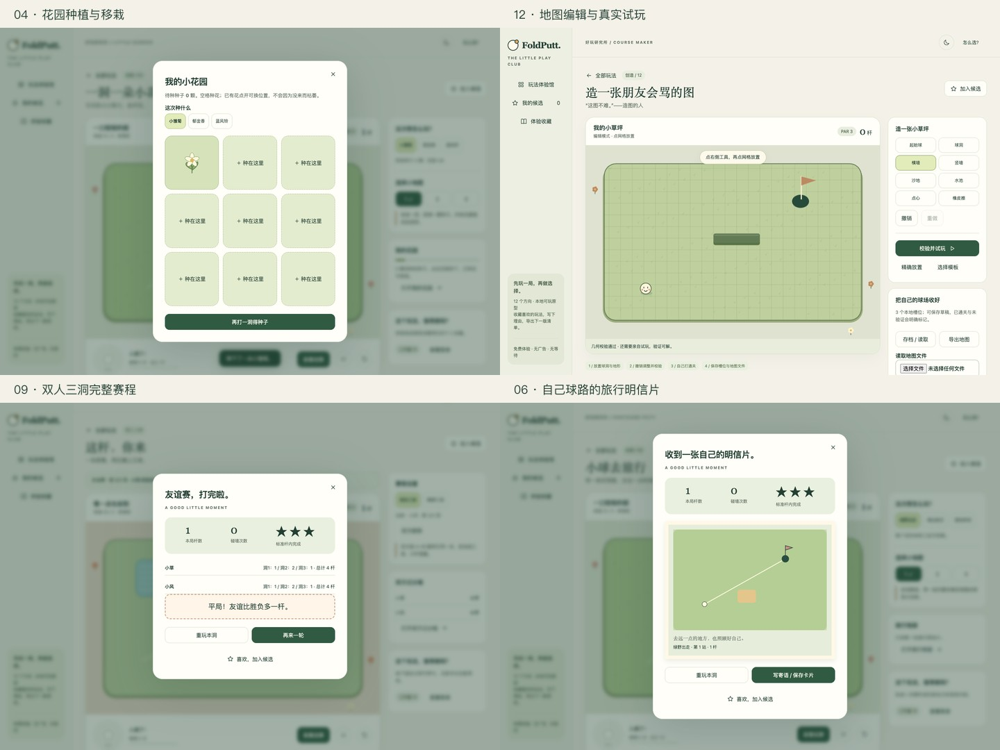

# 12 个方向可玩体验馆 · 2026-10-10

> 2026-10-11 更新：用户已接受推荐的 07＋04＋03 组合，三项已接入原生 App，见 [原生交付](club-native-delivery.md)。下文保留浏览器体验馆交付当时的范围。

## 本次交付与边界

依据用户“交互层级多、可玩性强、先体验再选择”的请求，新增独立浏览器成果 `prototype/play-club/FoldPutt-好玩研究所.html`，提供源文件、单文件离线版和真实浏览器截图。正式 Swift / UIKit 工程未接入这些候选功能。本轮不需要再次确认技术栈：这是用户已授权的交互方案验证。

共同主线是：**体验馆 → 选择变体或地图 → 真实拉杆击球 → 结算 → 收藏/成长/比赛下一轮 → 候选评分与导出**。复杂度放在目标、赛程与创造工具上，主操作仍只有单指向后拖拽、松手击球。

### 十二个可体验循环

| # | 方向 | 实际可交互内容 | 第二层与后续目标 |
|---|---|---|---|
| 01 | 今天打颗小团子 · 沙雕 | 3 种食物球、3 张球场、真实拾取点心、进盘子 | 完整拾取才收印章；9 枚图鉴、换球重试 |
| 02 | 本球先下班了 · 沙雕 | 3 种工作日、不同桌墙路线、门禁卡、EXIT | 按标准杆/入水/完成情况盖不同打卡章 |
| 03 | 嘴硬冠军俱乐部 · 沙雕 | 嘴硬/温柔/安静语气；真实击球、碰墙、擦洞、入水等事件 | 6 类事件各两条台词，逐条收录语录册 |
| 04 | 一洞一朵小花 · 治愈 | 完成球道获种子、自由选择 3 种花 | 九格种植、收回种子、换位置和品种、本地保存 |
| 05 | 今晚，慢慢打 · 治愈 | 3 种氛围、9 洞、独立声音开关、随时暂停 | 每洞点亮星空；退出后从未完成处继续，也能选旧洞 |
| 06 | 小球去旅行 · 治愈 | 3 个目的地 × 3 站、真实球路生成明信片 | 写寄语、保存 SVG 图片、打开旅行册、去下一站 |
| 07 | 借一面墙的力 | 6 张可解球场、沙地/水池/窄门/墙 | 通关记录＋标准杆内至少一次反弹的精通徽章 |
| 08 | 今天这一洞 | 日期确定地图、无限重试、个人最佳 | 近 7 日挑战随时补玩、记录保存在本浏览器 |
| 09 | 这杆，你来 | 双方昵称、轻松/障碍赛、每洞 A→B 同图 | 交接设备确认、6 回合记分、3 洞合计揭晓胜者 |
| 10 | 和昨天的自己赛跑 | 首次完成录制自己的轨迹；3 种练习 | 最佳路线虚线与幽灵球同步显示，少杆/同杆更快刷新 |
| 11 | 三洞，一口气 | 连续 3 洞、不中断淘汰、普通/一杆目标 | 分洞杆数、整轮合计、连续一杆挑战、个人最佳 |
| 12 | 造一张朋友会骂的图 | 8 工具、网格放置、精确坐标、撤销/重做、模板 | 几何校验→亲自通关→验证标记；3 存档、JSON 导入/导出 |

“玩法不同”体现为目标和完成后的行为不同。原型复用 6 张基础物理地图，睡前最后 3 洞使用镜像布局；不是 12 套独立物理引擎，也不是完整商业内容库。食物外观不修改碰撞数值；花园不加属性；没有生命耗尽、付费、广告、强制签到或等待解锁。

## 选择机制与市场判断

每个方向都能加入候选、按复玩意愿评 1–5 星、记录理由，并导出 Markdown 清单。导出代表用户筛选，不自动触发正式开发。体验收藏全部来自实际操作，没有预填奖杯、假玩家、假排行榜或假评论。

建议先试 **07 反弹解谜＋04 花园＋03 嘴硬球友**：分别观察技巧深度、成长目标和角色辨识度。备选是 06 旅行（偏内容分享）、09 双人（偏聚会）。12 编辑器潜力大，但内容治理、易用性与可解性成本高，建议第二阶段。

与先前“低成本优先”的建议相比，本轮组合优先考虑玩法互补与复玩，而非纯实现速度。市场参考沿用已核实的官方资料，见 `docs/feature-directions.md`。以上是设计假设，尚无用户实验或留存证据，不能保证市场占有率。

小规模试玩建议：邀请 8–12 位目标玩家，各体验三种不同类别；记录首次独立完成、主动开始第二局、收藏理由、24–48 小时后主动回访。优先选择“玩家实际再玩”的组合，而非只凭画面投票。

## 原型适配与状态

- 桌面三列卡片、游戏＋侧栏；窄屏单列游戏和下方功能区。四边 CSS 安全区独立处理。
- 运行中的球禁止再次击球；半透明拉杆＋文字状态共同提示。停球后恢复。
- 弹窗/标签页隐藏暂停；切图清理旧回调；关闭结算仍可用“查看结算”返回。
- 系统 Reduce Motion 可运行中切换，关闭装饰运动；物理球路保留必要反馈。声音默认关闭。
- Tab 焦点、原生对话框焦点约束、方向键等价击球、编辑器坐标输入；未完成全面屏幕阅读器评估。
- 成绩与收藏在浏览器本地；真实轨迹采样用于幽灵与明信片。服务器、账号、社区和在线分享均未实现。

## 验证与截图

最终验证结果、截图环境与限制见 `docs/screenshots/play-club/manifest.json` 和 `work/play-club/verification.json`。所有 PNG 均来自实际浏览器渲染，不是 UIKit、iPhone 或 DUO 模拟器截图。浏览器视口不是系统 size classes；本轮未调用 reserved regions，也未声称完成 DUO 开合、真机触感或光学验证。

最终通过 **93 项完整流程＋18 项补充检查**，其中包括 31 次真实鼠标击球和独立 CDP 触摸击球。6 张基础地图全部真实通关；双人赛 6 回合、接力 3 洞、编辑器通关与已验证存档均完成。覆盖 320–1440px 视口及 844×390 横向短屏；所有被检可见按钮至少 44×44 CSS px。离线 HTML 加载、保存、错误导入、运行中 Reduce Motion 和暂停恢复通过，浏览器无脚本异常。

测试方法：规划器只在独立物理副本中寻找可行角度，实际页面通过鼠标拖拽拉杆发射并等待真实碰撞/入洞；没有直接调用胜利回调或注入奖品。测试生成的收藏仅存在于隔离测试浏览器，交付文件没有预填进度。早期地图数据与自动化选择器问题及其修正有过程日志，最终结果为准。

