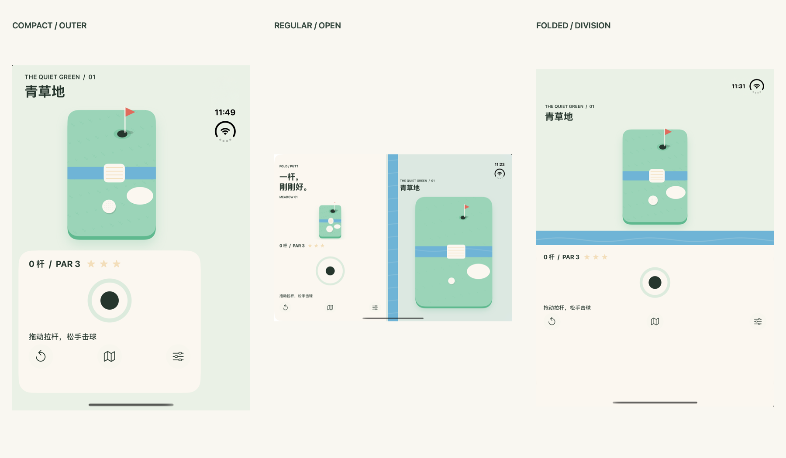

# 可运行三态原型交付

工程根目录：/Users/cws/Desktop/FoldPutt。打开 FoldPutt.xcodeproj，Scheme 为 FoldPutt，bundle ID 为 com.foldputt.prototype。

Swift + UIKit；SceneDelegate/WindowScene；没有 SwiftUI、Objective-C 源码、桥接头或第三方 App 依赖。iOS 27.1 SDK 构建通过，3 个核心单元测试与 1 条真实 UI 自动化流程通过。



## 新增内容

```text
FoldPutt/
├── FoldPutt.xcodeproj/              # App、单元/UI 测试 target、共享 scheme
├── App/                            # AppDelegate、SceneDelegate、Info.plist
├── Models/FPDemoSession.swift       # 单会话 mock 状态
├── Views/                          # 自适应容器、球道、操控区、拉杆
├── Systems/
│   ├── Input/FPPullMath.swift       # 死区、向量、归一化力度
│   └── FoldAdaptation/FPRegions.swift
├── Resources/
│   ├── Assets.xcassets/            # 11 Color Sets、9 PDF 游戏件、纹理、AppIcon
│   ├── Exports/                    # 球/旗 1024 透明 PNG
│   ├── Backgrounds/canal-tile.png
│   ├── AIConcepts/                 # 空，未伪造 AI 图
│   └── Motion/FPTheme.swift        # 字体、圆角、阴影、色彩、时长
├── Tests/、UITests/
├── Tools/                          # 工程/资产/提示词/截图汇总工具
└── docs/
    ├── prototype-implementation-plan.md
    ├── prototype-runbook.md
    ├── assets-manifest.md
    ├── ai-image-prompts.md
    ├── existing-document-updates.md
    ├── new-files.txt
    └── screenshots/                # 真截图 + 每态 JSON + manifest
```

完整文件列表见 [new-files.txt](new-files.txt)。资源用途和格式见 [assets-manifest.md](assets-manifest.md)。命令、人工步骤、测试证据和未测项见 [prototype-runbook.md](prototype-runbook.md)。AI 降级交付为 [54 条 UI prompt + 1 条纯背景 prompt](ai-image-prompts.md)。

## 可演示范围

- 外屏导航单栏、底部拉力环、可收小地图 sheet。
- 内屏 UISplitViewController，左侧操控区、右侧球道，真实 division/occlusion 避让；中缝绘制运河。
- 半折的真实活跃水平 division 自动上下布局，另有手动“掌机模式”入口。
- 球/手柄起点限定，拖动产生方向/力度，死区取消，松手 mock 出球且只计一杆。
- 菜单可演示开球、入洞和安全点回退；四项动效常量及 Reduce Motion 分支已落地。

## 明确边界

出球采用直线插值演示；没有完整物理、运河碰撞、关卡系统或商店/账号/社交。三态使用真实 iPhone Duo runtime 截图，不是 AI 概念图；AI 生成工具不可调用，已按用户要求交 prompt 清单。

README、CHANGELOG、AGENTS 等原有 11 份文档在本轮校验中保持原样。前三份的追加更新已准备并请求确认；不因原文过时而静默覆盖。完整原型信息可直接阅读本交付文档和运行手册。
